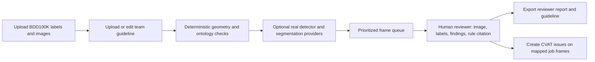

# QC Studio — workflow and implementation status

## Intended review flow

## Current repository state

| Area | Implemented now | Limitation |
|---|---|---|
| Frontend | Blazor/MudBlazor has BBox and semantic Segmentation modes, upload/setup, prioritized BBox queue, canvas, issue panel, guideline editor, and export view. Segmentation validates image/color-mask pairs and previews a true mask overlay. | Segmentation currently provides visualization only; no pixel-level QC, model inference, mask editing, or segmentation-to-CVAT correction export. |
| Dataset upload | Blazor accepts BDD100K JSON, optional Markdown/text guideline, and optional matching images for local preview. | JSON is currently kept in UI session memory; no persistent dataset/job database, batch upload service, or zip ingestion. |
| Rule engine | Existing bbox geometry, ontology, duplicates, aspect ratio, and polygon validity rules run via the Python API. Semantic `lane`/`drivable area` polygons are not object classes. | Team rules may need calibration against authoritative gold labels; `NEAR_BOUNDARY_UNMARKED` assumptions can flag valid source labels. |
| Model checks | `/api/qc/run` uses the installed local CVAT BBox function and local DINOv3 semantic-mask provider. Model disagreement is a human-review candidate. | The prior turn verified actual local provider responses on one authentic BDD image. Per-class gold-set calibration, class coverage and latency testing remain required before claiming model quality. |
| Segmentation | BDD train-ID mapping is fixed to IDs 0–18; ID 255 is ignored. Local predicted masks are compared with uploaded train-ID PNGs and produce class IoU and review candidates. | Other datasets must upload an explicit class/mask-ID profile. Model output missing a class is represented as disagreement; no predicted mask is ground truth. |
| CVAT handoff | Confirmed issues can be created through CVAT Issues API with exact frame metadata map or reviewer-confirmed order and evidence position. | Backend-scoped CVAT token and disposable-job write test are required. This creates issues; it does not modify annotations or reopen a job. |
| Review ranking | Frames are ordered by severity then rule-finding count. | Recall@20 is now unavailable until the run is evaluated against independent adjudicated ground truth; no target is hard-coded. |
| Guideline | API can load, edit, and cite a team guideline; Blazor can upload/edit/export it. | Current manager is process memory only and should be versioned/persisted before team use. |
| CVAT | Backend endpoint creates CVAT issues using environment-only PAT, job id, and frame offset; identical messages in first fetched issue page are skipped. | User must ensure uploaded frame order and frame offset match the CVAT job. Does not alter annotations or automatically return/reopen jobs. |
| Reports | Export reviewer Markdown, CSV issue register, and guideline Markdown. | Report should retain model/provider/version provenance when real providers are introduced. |
| Test data | `test-data/bdd100k-val-40/` contains the original 40-frame smoke pack. `test-data/bdd100k-walkthroughs/` contains four disjoint 50-frame packs: two BBox and two semantic segmentation with original train-ID and color PNG masks. | Detection `poly2d` examples are kept separately in `test-data/bdd100k-poly2d-reference/`; they are not semantic masks. Source labels/masks are unchanged; rule findings are unadjudicated candidates. Dataset terms apply. |

## Smoke-run outcome

Running the current QC CLI on the included 40-frame set processed 40 frames and 1,081 object labels. It reported 16 structural-rule findings across 9 frames; 31 frames had no finding from the enabled heuristics. The simulated proposal path was disabled. Recall@20 and error precision/recall are unavailable until independent gold labels are provided. Treat this pack as a real-data wiring/smoke check, not a benchmark.

## Recommended build plan

1. **Keep the first benchmark scope explicit:** BDD100K BBox and semantic segmentation only. Treat road-object `box2d`, lane `poly2d` paths, drivable-area polygons, and semantic train-ID PNGs as distinct shape families. Keep arbitrary formats, 3D cuboids, pose, and VLM reasoning outside this validated path until their parsers and adjudicated tests exist.
2. **Make the input contract explicit:** validate frame names, dimensions, class/shape pairs, attributes, coordinate bounds, image-to-label matching, CVAT task/job mapping, and source checksums. Preserve the original upload unchanged and report row-level parse problems.
3. **Harden rules before AI:** keep deterministic checks for malformed geometry, unknown classes, duplicate boxes, and shape/category mismatch. Make policy-dependent checks configurable and cite the exact approved guideline version. A model prediction alone must be a review candidate, never an automatic error.
4. **Connect one local BBox detector first:** add a provider adapter around the existing CVAT Nuclio model, map output class IDs to the task ontology, run one real image end to end, and record model/weight version, confidence, timing, and device. Compare against human annotations with class-aware matching; do not start with a five-model ensemble.
5. **Implement segmentation QC as a separate task:** preserve train-ID masks, define class-aware pixel rules and ignore handling, then compare model predictions only on adjudicated samples. A detector plus SAM can propose instance masks, but that is not a replacement for semantic-mask validation. Do not present the current overlay preview as QC or model inference.
6. **Build a real evaluation set:** the 40 authentic images are suitable to validate parsing, overlays, queue behavior, and exports. Separately adjudicate a larger, stratified set by source video and class with two reviewers before reporting error precision, Recall@20, reviewer-time savings, or model comparisons.
7. **Make review handoff safe:** resolve image filenames to CVAT task frame IDs, preview the exact issue payload, create frame-linked CVAT issues, and retain the created IDs. Do not call this “return/reassign job”; annotation re-import is a separate, reviewed operation. Check the installed CVAT edition because immediate feedback and quality analytics are listed for Online/Enterprise, while Community is self-hosted and has separate supported features.
8. **Version the outputs:** store dataset/run IDs, guideline version/hash, model provenance, reviewer decisions, and export manifest. Export guideline changes as proposals; only a human-approved edit becomes the next active version.

See [FLOW_REVIEW.md](FLOW_REVIEW.md) for the audit of the flow screenshots, evidence, and acceptance criteria.

See [AI_RECOMMENDATIONS.md](AI_RECOMMENDATIONS.md) for model/privacy/CVAT research and [IMPLEMENTATION_NOTES.md](IMPLEMENTATION_NOTES.md) for this work log.
