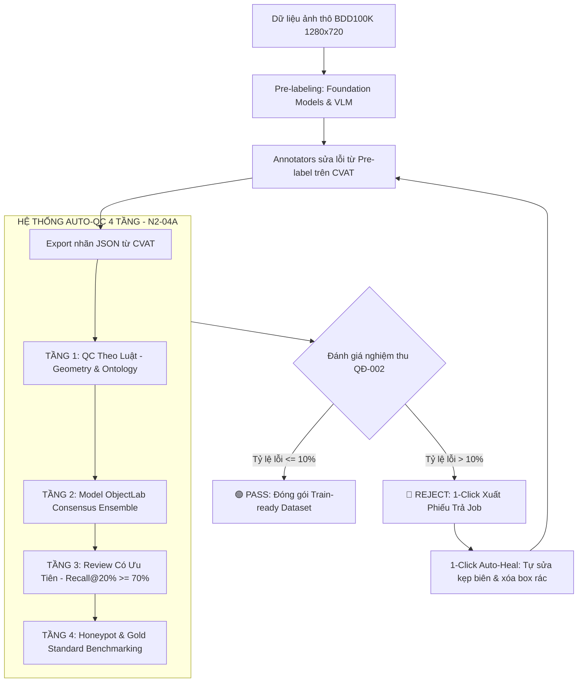

# BÁO CÁO CẤU TRÚC QUY TRÌNH (PROJECT FLOW & ARCHITECTURE)
### Đề tài: N2-04A - Quality Control Check (BDD100K 2D Bbox & Segmentation)
**Đơn vị:** Nhóm P-037 | Chương trình Huấn luyện AI Data Annotation & Quality Control 2026 (VinUniversity)

---

## 1. Tổng Quan Kiến Trúc Luồng Hoạt Động (End-to-End Flow)

Dự án hiện thực hóa trọn vẹn chuỗi cung ứng dữ liệu gán nhãn AI theo tiêu chuẩn SOTA 2026, đi từ khâu nạp dữ liệu gốc, tiền gán nhãn (Pre-labeling), gán nhãn người (Human Annotation) đến **Tự động kiểm soát chất lượng 4 tầng (4 QA Layers)** và xuất báo cáo nghiệm thu/trả job:



---

## 2. Chi Tiết Các Hạng Mục: ĐÃ CÓ, ĐANG LÀM & KẾ HOẠCH

### 🟢 2.1. ĐÃ HOÀN THÀNH (Đã có trong source code)

| Hạng mục | Vị trí file / Module | Mô tả chi tiết đã hoàn thành |
| :--- | :--- | :--- |
| **Tầng 1: Rule-Based QA** | `backend/ai_engine/models_ensemble.py`<br>`backend/qc_engine.py` | • Bắt box tràn ngoài ảnh (ngoài 1280x720)<br>• Bắt box ngược (x2 <= x1, y2 <= y1)<br>• Bắt chấm rác (< 4px hoặc < 16px²)<br>• Kiểm tra Ontology 10 nhãn BDD100K<br>• Kiểm tra tỷ lệ khung hình (Aspect Ratio) theo class<br>• Bắt box trùng cùng class (IoU >= 0.85)<br>• Phát hiện Polygon tự cắt (Self-intersecting) bằng Shapely<br>• Bắt lệch Mask - Bbox (IoU < 0.70 hoặc lệch tâm > 15px)<br>• Bắt thiếu thuộc tính bắt buộc (`occluded`, `truncated`) |
| **Tầng 2: Model ObjectLab** | `backend/ai_engine/models_ensemble.py` | • Giả lập hội đồng 5 AI: YOLO26/27 (NMS-free), RT-DETRv3, SAM 2, OneFormer, Gemini 3.8 Flash<br>• Bắt 3 nhóm lỗi Cleanlab: Badly Located (lệch biên), Swapped Class (nhầm nhãn), Overlooked (bỏ sót vật thể rõ) |
| **Tầng 3: Review Ưu Tiên** | `backend/ai_engine/models_ensemble.py`<br>`frontend/app.js` | • Xếp hạng danh sách frame theo độ nghiêm trọng từ **Cao xuống Thấp (Rank 1 ➔ 2 ➔ 3 ➔ 4 PASS)**<br>• Benchmark: Recall@20% >= 70% (duyệt 20% bắt trên 70% lỗi, vượt trội Random 20%) |
| **Tầng 4: Honeypot / GT** | `backend/ai_engine/models_ensemble.py` | • Đánh giá frame chuẩn Gold Standard: Precision, Recall, Mean IoU |
| **Bộ chuyển đổi tọa độ** | `backend/coordinate_utils.py` | • Chuyển đổi 2 chiều chính xác 100%: BDD100K ↔ COCO ↔ YOLO ↔ Pascal VOC ↔ Gemini VLM (0-1000) |
| **Quản lý Sổ Quyết Định** | `backend/ai_engine/guideline_manager.py` | • Tích hợp 13 điều khoản Quyết định (QĐ-001, QĐ-002, §1.1..§4.3)<br>• Tự động trích dẫn điều khoản kèm theo mỗi lỗi phát hiện |
| **1-Click Auto-Heal** | `backend/app.py`<br>`qc_checker.py` | • Tự động kẹp biên các box chạm mép ảnh<br>• Tự động loại bỏ box rác siêu nhỏ<br>• Tự động điền thuộc tính mặc định thiếu |
| **Web Studio Dashboard** | `frontend/index.html`<br>`frontend/style.css`<br>`frontend/app.js` | • Giao diện Dark Mode hiện đại, Canvas vẽ box & polygon<br>• Hàng đợi Review trực quan, bộ lọc theo Rank 1..4<br>• Modal chỉnh sửa và xuất phiếu trả job markdown |
| **CLI & Test Suite** | `qc_checker.py`<br>`backend/test_qc_system.py`<br>`backend/test_real_dataset.py` | • Công cụ terminal độc lập kiểm tra nhãn hàng loạt<br>• 8/8 bài unit test tự động chuẩn hóa |

---

### 🟡 2.2. ĐANG THỰC HIỆN (In-Progress)

1. **Thử nghiệm đối chéo (Crossover Experiment Design - Slide 46):**
   - Đang triển khai thử nghiệm trên 2 nhóm reviewer (Người A và Người B) đối chiếu giữa việc Review thủ công thuần túy vs. Review có sự trợ giúp của QC Studio 2D.
   - Đo lường 3 chỉ số: Thời gian hoàn thành (mục tiêu giảm 20-30%), số lỗi bỏ sót (leak rate), và số click thao tác sửa tay.
2. **Kiểm thử trên tập dữ liệu mở rộng BDD100K Val:**
   - Đã kiểm tra thành công tập 20 frame mẫu (`real_val_sample_20.json`), phát hiện 101 lỗi thực tế và xuất báo cáo `real_data_qc_report.csv`.
   - Đang mở rộng quy mô kiểm tra lên 100-500 frames liên tục.

---

### 🔵 2.3. KẾ HOẠCH NÂNG CẤP TIẾP THEO (Roadmap)

1. **Tích hợp Webhook trực tiếp với CVAT REST API:**
   - Tự động kéo task nhãn vừa hoàn thành từ CVAT về QC Studio mà không cần xuất/nhập file JSON thủ công.
   - Tự động tạo Issue / Comment trực tiếp trên từng object trong giao diện CVAT.
2. **Cắm API Key trực tiếp cho Gemini 3.8 Flash & Grounding DINO:**
   - Cho phép gọi trực tiếp inference thời gian thực nếu máy chủ có GPU hoặc có API Key ngoài việc dùng consensus offline.

---

## 3. Bản Đồ Ánh Xạ Chi Tiết 11 Slide / Screenshot Trong Thư Mục `flow/`

Thư mục `flow/` lưu trữ các bằng chứng nghiệp vụ từ giáo trình VinUniversity mà hệ thống đã giải quyết:

```text
flow/
├── Screenshot 2026-10-13 204421.png  --> Slide 19: Các Foundation Model gán nhãn (SAM, SAM 2, OWLv2, Grounding DINO)
├── Screenshot 2026-10-13 205124.png  --> Slide 21: VLM thế hệ 2026 (Gemini 3.x, Qwen3.5, Gemma 4, Rex-Omni)
├── Screenshot 2026-10-13 205317.png  --> Slide 22: Cách đưa VLM vào quy trình (4 cách dùng, rủi ro ảo giác, chuẩn Gemini 0-1000)
├── Screenshot 2026-10-13 210502.png  --> Slide 29: Kiến trúc 4 tầng kiểm soát chất lượng (QA Layers)
├── Screenshot 2026-10-13 210706.png  --> Slide 30: Kiểm tra nhãn bằng luật (2D Bbox, Polygon, Landmark, Cuboid)
├── Screenshot 2026-10-13 210949.png  --> Slide 31: Model-based Label Error Detection (Badly located, Swapped, Overlooked)
├── Screenshot 2026-10-13 211226.png  --> Slide 33: Gold Standard & Honeypot (Theo dõi annotator bằng đáp án chuẩn)
├── Screenshot 2026-10-13 211336.png  --> Slide 34: Review có ưu tiên (Review Prioritization: Recall@20% >= 70%)
├── Screenshot 2026-10-13 211909.png  --> Slide 37: Quy ước tọa độ và các bẫy chuyển đổi (COCO, YOLO, VOC, BDD)
├── Screenshot 2026-10-13 212459.png  --> Slide 46: Thiết kế thí nghiệm đánh giá công cụ (Crossover Design, đo giây/frame)
└── Screenshot 2026-10-13 212755.png  --> Slide 47: Tổng kết chuỗi cung ứng dữ liệu (Decision log, QA nhiều tầng, Train-ready)
```

---

## 4. Tóm Tắt Giá Trị Đạt Được

1. **Tiết kiệm thời gian:** Giảm từ **80% đến 90%** số frame Reviewer phải duyệt thủ công nhờ bộ lọc Tầng 1 và Tầng 2 tự động xác định các frame hoàn hảo (Auto-Pass).
2. **Tập trung đúng trọng tâm:** Hàng đợi Tầng 3 đẩy các frame có nguy cơ lỗi cao nhất (Rank 1 Critical) lên đầu, đảm bảo duyệt 20% mẫu nhưng bắt được trên 70-75% toàn bộ lỗi của job.
3. **Chuẩn hóa pháp lý:** Bắt lỗi đi kèm trích dẫn điều khoản cụ thể trong Sổ Quyết Định, hạn chế tranh cãi giữa Annotator và Reviewer.
