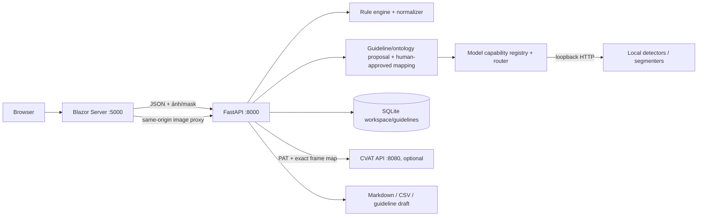
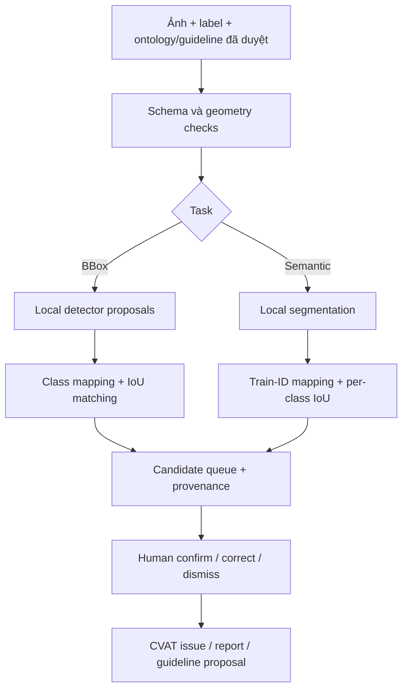

# Thiết kế hệ thống QC Studio — BP

**Phạm vi:** repo `BP`, ưu tiên BDD100K 2D. Không đọc toàn bộ archive data, không sửa `P307`, không thay đổi CVAT database/volume. Tài liệu tách bạch code hoạt động với kiến trúc đề xuất.

## Quyết định thiết kế

1. **Local-first, provider-independent.** QC API điều phối parser, rule engine, model adapters, workspace và export. Detector/segmenter/VLM là provider tùy chọn; frontend không gọi trực tiếp model vendor.
2. **Rule và model khác vai trò.** Rule kiểm tra điều xác định từ nhãn/schema; model đưa proposal/disagreement. Model không phát hiện vật thể không đủ để kết luận nhãn sai. Mọi quyết định sửa/đẩy CVAT do reviewer.
3. **Guideline quyết định đối tượng cần kiểm tra; ontology quyết định cách biểu diễn.** Trích các class, alias, mô tả nhận diện, điều kiện/exclusion và annotation target từ guideline thành bản đề xuất có cấu trúc; đối chiếu với dataset labels/profile và capability của model. Người dùng duyệt những class/mapping không chắc chắn trước khi chạy. BDD road object `box2d`, detection `poly2d` (lane/drivable area) và semantic train-ID masks khác nhau; không coi `poly2d` là mask segmentation.
4. **Guideline có revision/hash.** Mỗi run gắn guideline version/hash. Export sinh proposal từ issue đã Confirm; proposal không tự active.
5. **Review và CVAT cùng luồng.** Từ issue/frame ở trang Review, tạo issue trong đúng CVAT job kèm frame index, evidence position, rule/model finding và hướng dẫn người gán nhãn; có thể gán người phụ trách và tuỳ chọn trả Stage/State. Không overwrite annotation tự động. Chưa xác nhận thao tác ghi trên job thật.
6. **Gemini là provider tuỳ chọn, không phải điều cấm.** Người dùng có thể bật Gemini cho từng workspace/run để trích guideline thành ontology có cấu trúc và/hoặc kiểm tra ảnh, sinh thêm proposal. Khi bật vision, ảnh gửi ra Google Gemini API; phải có cảnh báo và consent rõ, key chỉ ở backend, giới hạn số ảnh/chi phí và lưu provenance. Chế độ local-only không gọi Gemini.

## Kiến trúc hiện tại

App và API bind `127.0.0.1`; model adapters mặc định loopback. Frontend gọi API bằng server-side `HttpClient`. Ảnh archive fallback được tìm trong đường dẫn cục bộ. Ảnh preview fallback được proxy cùng origin qua Blazor để browser không hard-code địa chỉ API.

## Luồng người dùng và trạng thái code

| Bước | Hành vi | Trạng thái / giới hạn |
|---|---|---|
| Prepare | Chọn BBox/semantic segmentation; nạp nhãn, guideline, profile và ảnh/mask | Có upload UI, JSON/profile parse, check cặp ảnh/mask. Upload giữ trong memory của Blazor circuit; chưa có resumable/server-side upload. |
| Validate | Kiểm schema/ontology, filename/dimensions, profile và model readiness | API normalization và một số dimension/mapping checks chạy trong QC. Chưa có trang preflight đầy đủ trước khi chạy. |
| Analyze (hiện tại) | Mode chọn trước route cố định BBox hoặc semantic-mask; local trước, Gemini vision tùy chọn theo từng run | BBox class list lấy từ profile/labels; Segmentation dùng class mapping/profile. Checkbox Gemini gửi guideline + tối đa 50 ảnh (mặc định 10) lên Gemini để đề xuất candidate; không ghi nhãn gốc. Guideline chưa được trích thành ontology, vì vậy đây chưa phải bộ định tuyến class hoàn chỉnh. Provider health không chứng minh chất lượng. |
| Review | Queue ưu tiên; chọn frame; xem ảnh + annotation/model overlay + issue/evidence/citation; Confirm/Dismiss | Có giao diện ba cột và nút decision. Run/decision còn trong phiên Blazor; refresh/đóng tab làm mất. |
| Handoff | Gửi finding tới CVAT và tuỳ chọn đổi Stage/State | API tạo issue với frame/position/message, bỏ qua issue trùng; checkbox hiện mặc định cho phép gửi cả pending candidates và đổi Job sang `annotation/rejected`. Đây là side effect thật, cần người dùng rà soát job/map trước khi bấm. Không sửa annotation. Chưa ghi thử vào CVAT trong lượt kiểm chứng hiện tại. |
| Export | Reviewer report, CSV và guideline proposal | Có Markdown/CSV và draft từ issue confirmed. Chưa lưu run manifest bền vững. |

## Luồng mục tiêu theo yêu cầu

1. **Prepare:** upload ảnh + labels + guideline (và profile/mask khi task cần). Chuẩn hóa schema, đọc taxonomy hiện có và trích guideline thành ontology/policy proposal: canonical object/class, aliases, mô tả dương tính, trường hợp loại trừ, loại annotation cần tạo (box, instance polygon/mask, semantic mask), điều kiện/attribute và clause nguồn. Hiển thị nội dung trích dẫn để reviewer sửa/duyệt; không coi parse tự động là policy đã duyệt.
2. **Model preflight:** hợp nhất class đã duyệt từ guideline với dataset profile/labels. Lập bảng theo từng class: model/provider phù hợp, loại output, label mapping, threshold, khả năng chạy local, và trạng thái `supported / promptable / unsupported`. Không được chỉ lấy class có trong labels vì cần tìm cả object guideline yêu cầu nhưng đang bị bỏ sót. Nếu không có model hỗ trợ thì báo coverage gap và không giả vờ đã QC class đó.
3. **Route theo capability:** BBox closed-set detector cho ontology cố định/domain-trained; open-vocabulary detector (Grounding DINO) nhận tên/mô tả đã duyệt để đề xuất box cho class mới/chưa có nhãn. Với instance polygon/mask, dùng detector box/proposal rồi segmenter; đánh giá SAM 3 cho text-concept detection+segmentation, giữ semantic DINOv3 cho taxonomy/mask BDD mà nó thật sự hỗ trợ. Private VLM chỉ hỗ trợ phân loại ambiguity/đọc điều khoản, không tạo ground truth hay tự quyết nhãn.
4. **Compare & issue:** đối chiếu predictions với annotation gốc và các quy tắc trong guideline. Sinh issue có loại sai lệch, class, model/version, confidence, clause, ảnh/overlay và vùng bằng chứng. Phân biệt `label missing`, `annotation not confirmed`, `class mismatch`, `unsupported class`; tất cả model findings đều là review candidates, không kết luận sai tự động.
5. **Review (trang 2):** frame queue được ưu tiên; giữa là ảnh với annotation gốc và prediction overlays; panel issue hiển thị bằng chứng, clause và quyết định. Từ issue đã chọn gửi CVAT issue vào đúng job/frame và evidence location; gán assignee nếu cần, sau đó tùy chọn đổi job sang annotation/rejected để annotator thấy việc cần sửa. Exact frame map là điều kiện trước khi ghi. Không import/replace annotation; sửa xong annotator thao tác trong CVAT.
6. **Delivery (trang 3):** xuất report, issue CSV, model coverage/mapping và guideline update draft. Draft phải được policy owner duyệt rồi mới activate thành version kế tiếp.

### Vai trò của Gemini trong flow

- **Guideline text pass:** Gemini tạo class/alias/visual cue/exclusion/annotation target/clause references theo JSON Schema; reviewer sửa và duyệt trước khi các lớp được đưa vào model router.
- **Vision pass (tuỳ chọn rõ ràng):** Gemini xem ảnh được chọn để thêm detection/attribute proposals theo các class đã duyệt; chạy trên các frame trong batch mà user chọn, không ngầm gửi cả archive. Kết quả là VLM candidate có confidence/evidence, không phải nhãn thật.
- **Model fusion:** giữ YOLO26x/EoMT-DINOv3 local làm specialist providers; ghi riêng nguồn `local detector`, `segmentation`, `Gemini`. Đối chiếu disagreement bằng issue để reviewer xử lý; không để Gemini ghi đè local labels/masks.
- **Privacy modes:** `Local only` không gửi dữ liệu ra ngoài; `Gemini assist` gửi guideline text và ảnh/crops được chọn tới Google. API key trong backend environment, model ID cấu hình được, per-run limit/cost estimate và request/response audit không lưu ảnh/prompt thừa. Free-tier terms cho phép dùng dữ liệu để cải thiện sản phẩm và có thể human review; không gửi dữ liệu nhạy cảm qua free tier. Paid API không dùng prompt/ảnh/response để cải thiện sản phẩm nhưng vẫn phải kiểm tra abuse-retention/ZDR terms.

**Khác biệt còn lại với code:** guideline hiện chỉ dùng cho rule/citation và được gửi làm ngữ cảnh Gemini vision khi user bật; bước trích ontology/model preflight vẫn chưa triển khai. Pipeline chọn provider cố định dựa trên mode BBox/Segmentation; BBox class list suy ra từ profile/labels nên không bảo đảm tìm class chỉ nêu trong guideline. Gemini proposals hiện khả dụng cho BBox-style object candidates (kể cả khi QC mode là segmentation, kết quả hiển thị như issues chứ không phải semantic mask). CVAT create-issue và optional job-state update có backend; panel đã ở Review nhưng vẫn cần pilot test với disposable job trước khi dùng job thật.

### Tích hợp Gemini đã triển khai

- Backend gọi REST `generateContent` qua `backend/gemini_provider.py`; key đọc từ file local `backend/GEMINI_API_KEY.txt` (hoặc biến môi trường `GEMINI_API_KEY` khi deploy), model từ `GEMINI_MODEL` (mặc định `gemini-3.8-flash`). File key bị Git ignore. Không thêm SDK dependency.
- Frontend gọi API kiểm tra cấu hình; bật riêng checkbox và chọn frame cap trước khi QC. Chưa có key thì checkbox disabled. Không có credential nào nhúng trong frontend.
- Response có JSON schema, chuyển tọa độ normalized Gemini `[ymin,xmin,ymax,xmax]` sang pixel, ghi thành issue/model proposal có `qa_layer=Gemini cloud candidate` và không mutate source labels.
- Hạn chế hiện tại: pipeline kiểm từng frame trong queue ưu tiên đầu tiên; đầu vào guideline + toàn bộ danh sách labels của frame có thể đi kèm request. Gemini box là gợi ý vision, chưa chứng minh class/geometry chính xác. API call thật chưa thể kiểm tra khi chưa có key hợp lệ; cần pilot ít frame trước khi chạy batch lớn.

## Hợp đồng dữ liệu

### BBox

- Adapter hỗ trợ BDD100K, COCO detection, normalized rows và JSON YOLO có manifest trong `qc_pipeline.py`.
- COCO `xywh` đổi thành pixel `xyxy`; YOLO JSON cần width/height và bbox normalized `cx,cy,w,h`. Không tự đoán YOLO `.txt` khi thiếu manifest/data.yaml.
- BDD `box2d` là road object. `poly2d` giữ riêng theo semantics/closed flag; hiện không biến nó thành semantic mask.
- Dataset profile cần khai ontology, aliases và model mapping rõ ràng.

### Semantic segmentation

- Cần manifest frame→image→train-ID mask và ontology theo ID. BDD mặc định ID 0–18, ignore ID 255.
- Chỉ chuyển color mask sang ID khi profile có `color_mask_to_id` tường minh; không suy ID từ thứ tự lớp xuất hiện.
- Ảnh/mask phải cùng kích thước. Per-class IoU chỉ so sánh dữ liệu trong run; không phải benchmark độc lập.

## Chiến lược model

- **BBox:** giữ detector local hiện tại làm baseline cho class BDD mà nó hỗ trợ; dùng Grounding DINO text-conditioned như proposal fallback cho class mới. Repo chính thức nhận cặp image/text prompt và code Apache-2.0; kiểm tra license checkpoint riêng và đo false positive theo class/domain. Nó không phải oracle.
- **Segmentation:** giữ local semantic-mask provider cho class/train-ID BDD được hỗ trợ. Đánh giá SAM 3 cho instance concept prompt vì model chính thức trả masks, boxes và scores; checkpoint cần quyền truy cập, môi trường mới (Python 3.12+, PyTorch 2.7+, CUDA 12.6+) và SAM License nên chưa tự động thay provider đang có.
- **VLM riêng tư:** chạy local Qwen3-VL (hoặc model VLM self-hosted tương đương) để trích guideline/giải thích ambiguity có schema đầu ra, nhưng không dùng nó để thay detector/mask model; repo công bố đường chạy local/vLLM và Apache-2.0, vẫn cần kiểm tra license checkpoint cụ thể, VRAM, egress/logging và chất lượng.
- **Gemini:** QC path hiện tại chưa gọi API; có thể thêm như provider tuỳ chọn cho guideline extraction và vision proposals. Giữ OFF mặc định, paid project cho dữ liệu dự án được phép gửi, giới hạn frame/cost và báo rõ dữ liệu nào sẽ rời máy. Free tier chỉ dùng data không nhạy cảm. Không cho browser gọi Gemini trực tiếp.
- Không thêm ensemble nhiều model trước khi một provider chạy ổn và model mới chứng minh cải thiện trên gold set với latency/VRAM phù hợp.

## Bảo mật và triển khai

### Máy cá nhân (khuyến nghị hiện tại)

- Chạy QC API, Blazor UI và model services trên cùng máy; CVAT có gateway loopback `127.0.0.1:8080`.
- SQLite/workspace data không commit. CVAT token chỉ ở process backend.
- Không expose cổng 5000/8000/3200x ra LAN/Internet. App chưa có auth hay multi-user isolation.

### Máy chủ nội bộ (bước deploy sau)

1. Tách services `web`, `qc-api`, persistent `qc-data`, `cvat`, `model-worker` (model có thể ở GPU host riêng).
2. Dùng DNS/service URL nội bộ thay vì `localhost` giữa containers; private network, firewall, TLS/reverse proxy và authentication trước khi mời nhiều người dùng.
3. Lưu file dataset trong object storage và run/reviewer metadata trong database; ghi hash, guideline revision, model/weights/preprocess, kết quả và CVAT IDs.
4. Bổ sung job queue, batching/progress/resume, quotas, retention, backup và idempotent run IDs trước dataset lớn.
5. Nếu bật Gemini, chỉ backend gọi; UI yêu cầu bật riêng vision upload, giới hạn payload/frame/token/cost, cung cấp local-only mode; review điều khoản, location, retention và ZDR cụ thể.

Dockerfile hiện chỉ đóng gói **Python API**. Chưa có Compose stack thống nhất cho Blazor + API + CVAT/Nuclio; API Docker image riêng không có nghĩa sản phẩm production-ready.

## Rủi ro cần xử lý trước production

| Ưu tiên | Rủi ro | Hướng xử lý |
|---|---|---|
| P0 | API/UI không có auth; loopback chỉ phù hợp local | Auth/authorization, CSRF/rate limits, audit, TLS và reverse proxy trước LAN/cloud. |
| P0 | Review decisions/run state mất khi refresh | Persist run, source hashes, issues, reviewer states, CVAT response IDs và exports. |
| P0 | Upload toàn bộ ảnh/mask vào circuit memory và JSON có thể rất lớn | Stream/chunk vào staging storage, validate manifest, quota/batch và cleanup. |
| P0 | CVAT mapping sai có thể gắn issue sai frame | Exact job mapping, kiểm filenames/count/indices, preview payload, idempotency, disposable job write test. |
| P1 | Model disagreement/heuristic không chứng minh label sai | Gold adjudication, policy rules có ID, đo issue precision/recall và false positives. |
| P1 | Model status healthy không chứng minh inference đúng | Smoke inference, overlay, checkpoint/device/class mapping/latency/VRAM. |
| P1 | Dataset ngoài BDD chưa tổng quát | Adapter + profile schema, format fixtures, mask ID mapping, versioned parser. |
| P2 | Bootstrap Icons tải từ jsDelivr nên UI cần Internet để có icon | Bundle asset offline để local-only không cần CDN. `App.razor` hiện tham chiếu CDN. |

## Kế hoạch triển khai

1. **Ổn định local run — đã triển khai:** start/stop, health check, same-origin image preview, hướng dẫn BBox + segmentation 50 ảnh. Health hiện báo các provider loopback sẵn sàng; smoke run cũ có kết quả nhưng cần chạy lại trên build hiện tại để xác nhận lại.
2. **Persist run:** upload staging, run IDs, results và reviewer states trong DB. Hoàn tất khi refresh/reopen giữ queue, decision và export.
3. **Guideline-to-model routing:** guideline parser sinh ontology/policy proposal có clause provenance; reviewer duyệt/sửa; capability registry map class→model/output/threshold; preflight cho thấy coverage gap; route từng class/task và lưu đầy đủ provenance. Chỉ chạy classes đã duyệt, nhưng không loại class do chưa có trong labels.
4. **CVAT pilot:** exact mapping, preview payload, push issue đã Confirm vào disposable job, giữ IDs và retry idempotent. Xác nhận đúng frame/job; kiểm tra riêng tuỳ chọn đổi Stage/State. Không overwrite annotation.
5. **Model benchmark:** gold subset stratified, scene/video-separated, hai reviewer adjudicate. Đo per-class precision/recall, missed-object rate, FP/100 frames, mask IoU, latency/VRAM/reviewer correction. So sánh detector local, Grounding DINO text prompts và SAM 3 concept segmentation trên cùng tập trước khi chọn.
6. **Deploy nội bộ:** auth, secrets, TLS, storage, backup/retention, monitoring, access control và compose/infra profile. Chưa public-cloud deploy trước các điều kiện này.

## Bộ dữ liệu kiểm thử local

`test-data/bdd100k-walkthroughs/` có bốn pack disjoint, mỗi pack 50 ảnh thật: hai BBox, hai semantic segmentation, có manifest/checksum. Chúng kiểm tra mechanics, không phải gold set lỗi đã adjudicate. Dùng pack 01/03 cho luồng cơ bản; 02/04 cho rule-candidate/class coverage. Không cần đọc toàn bộ BDD archive để chạy demo.

Thao tác: [INSTALL_AND_USE.md](INSTALL_AND_USE.md). Audit flow: [FLOW_REVIEW.md](FLOW_REVIEW.md). Nghiên cứu model/privacy/CVAT: [AI_RECOMMENDATIONS.md](AI_RECOMMENDATIONS.md).
