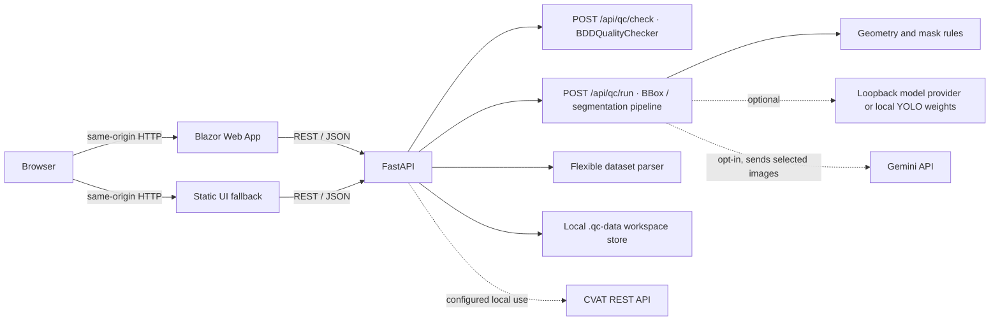
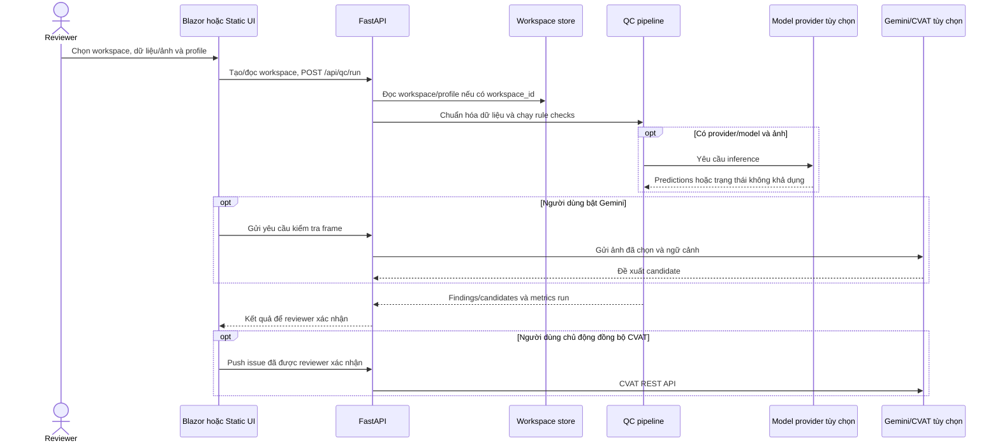

# Kiến trúc QC Studio 2D

## Sơ đồ triển khai chính

Blazor là giao diện chính trong các script chạy đầy đủ và trên Render. FastAPI cũng có thể phục vụ giao diện tĩnh thay thế; cả hai gọi API cùng origin. `POST /api/qc/check` là luồng kiểm tra dataset trực tiếp/legacy, còn `POST /api/qc/run` là luồng workspace cho BBox và semantic segmentation.

## Luồng review workspace

Đường dữ liệu theo phiên bản/deployment có thể khác nhau: ảnh và nhãn có thể nằm trong request hoặc workspace cục bộ. Không coi dữ liệu demo/runtime là dữ liệu bền vững trên Render Free. Gemini và CVAT là ranh giới truyền dữ liệu ra ngoài; không gửi dữ liệu nhạy cảm lên deployment công khai.

## Chạy và deploy

- `python backend/app.py` phục vụ `frontend/` tĩnh và FastAPI cùng một origin trên cổng 8000. Mặc định bind `127.0.0.1`; host/port có thể cấu hình bằng `HOST`/`PORT`.
- `run_qc_studio.ps1` / `.bat` khởi chạy backend trên 8000 và Blazor trên 5000. Blazor gọi `/api/qc/run`, hỗ trợ workspace, BBox và segmentation.
- `render.yaml` tạo Docker web service. Dockerfile publish Blazor .NET 10 và cài FastAPI; `start_container.py` chờ API sẵn sàng rồi chạy Blazor trên `$PORT`, đồng thời dừng container nếu một dịch vụ chết. `/healthz` kiểm tra cả UI và API.
- `QC_PUBLIC_DEMO=true` chặn ghi credential dùng chung và Gemini; CVAT vẫn có thể dùng token riêng theo phiên qua request headers.
- Container không cài model weights. Có thể cấu hình `QC_MODAL_API_URL` để gửi ảnh tới Modal CPU; nếu không có provider thì kết quả phải ghi rõ phần inference bị thiếu.

## Thành phần

- `backend/app.py`: API, phục vụ static UI, route upload/QC/export/workspace và tích hợp ngoài tùy chọn.
- `backend/qc_engine.py` + `backend/ai_engine/models_ensemble.py`: rule checks legacy BDD và hàng đợi heuristic. Các candidate cần reviewer xác nhận.
- `backend/qc_pipeline.py`: chuẩn hóa BBox và tính metrics so sánh mask theo run. Kết quả mask IoU không phải benchmark độc lập.
- `backend/ai_engine/local_model_providers.py`: provider loopback và inference YOLO local nếu đã cài dependency/weights.
- `backend/flexible_dataset_parser.py`: đọc các định dạng được hỗ trợ; giới hạn file/ZIP được đặt trong parser.
- `frontend/BlazorApp/`: giao diện chính trên local và Render; `frontend/`: giao diện tĩnh thay thế.
- `demo_data/`: sample fixtures; không được tự xem là gold set độc lập.
- `.qc-data/`: dữ liệu runtime cục bộ. Render Free không lưu bền vững nội dung tại đây.

## Ranh giới tin cậy và lưu trữ

- Browser giao tiếp với backend qua HTTP(S); hiện ứng dụng không có đăng nhập/phân quyền người dùng. Không mở endpoint này công khai để xử lý dữ liệu nhạy cảm.
- Quy tắc cục bộ có thể chạy không cần gửi ảnh ra ngoài. Gọi Gemini là opt-in và gửi ảnh/ngữ cảnh của frame được chọn tới Google; CVAT chỉ được gọi khi cấu hình và thao tác tương ứng.
- Workspace/configuration được quản lý bởi backend và workspace store trong `.qc-data/`. Không xem filesystem của container Render Free là nơi lưu trữ lâu dài.
- Kết quả model/rule là candidate hỗ trợ review. Việc Auto-Heal, export và push CVAT là thao tác riêng; reviewer phải xác nhận trước khi phát hành thay đổi bên ngoài.

## Ý nghĩa số liệu

LQS là điểm heuristic. “Không có cờ” chỉ có nghĩa không rule đang bật nào phát hiện finding. Model disagreement cũng không chứng minh nhãn sai. Chỉ báo cáo precision/recall khi có tập nhãn độc lập được adjudicate và protocol matching được định trước.
