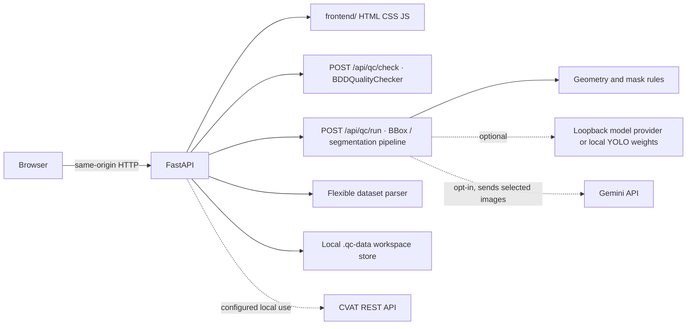

# Kiến trúc QC Studio 2D

## Sơ đồ triển khai chính

## Chạy và deploy

- `python backend/app.py` phục vụ `frontend/` tĩnh và FastAPI cùng một origin trên cổng 8000. Mặc định bind `127.0.0.1`; host/port có thể cấu hình bằng `HOST`/`PORT`.
- `run_qc_studio.ps1` / `.bat` khởi chạy backend trên 8000 và Blazor trên 5000. Blazor gọi `/api/qc/run`, hỗ trợ workspace, BBox và segmentation.
- `render.yaml` tạo Docker web service. Dockerfile publish Blazor .NET 10 và cài FastAPI; `start_container.py` chờ API sẵn sàng rồi chạy Blazor trên `$PORT`, đồng thời dừng container nếu một dịch vụ chết. `/healthz` kiểm tra cả UI và API.
- `QC_PUBLIC_DEMO=true` chặn ghi credential dùng chung và Gemini; CVAT vẫn có thể dùng token riêng theo phiên qua request headers.
- Container không cài model weights. Có thể cấu hình `QC_MODAL_API_URL` để gửi ảnh tới Modal CPU; nếu không có provider thì kết quả phải ghi rõ phần inference bị thiếu.

## Thành phần

- `backend/app.py`: API, phục vụ static UI, route upload/QC/export/workspace và tích hợp ngoài tùy chọn.
- `backend/qc_engine.py` + `backend/ai_engine/models_ensemble.py`: rule checks legacy BDD và hàng đợi heuristic. Các candidate cần reviewer xác nhận.
- `backend/qc_pipeline.py`: chuẩn hóa BBox và tính metrics so sánh mask theo run. Kết quả mask IoU không phải benchmark độc lập.
- `backend/ai_engine/local_model_providers.py`: provider loopback và inference YOLO local nếu đã cài dependency/weights.
- `backend/flexible_dataset_parser.py`: đọc các định dạng được hỗ trợ; giới hạn file/ZIP được đặt trong parser.
- `frontend/BlazorApp/`: giao diện chính trên local và Render; `frontend/`: giao diện tĩnh thay thế.
- `demo_data/`: sample fixtures; không được tự xem là gold set độc lập.
- `.qc-data/`: dữ liệu runtime cục bộ. Render Free không lưu bền vững nội dung tại đây.

## Ý nghĩa số liệu

LQS là điểm heuristic. “Không có cờ” chỉ có nghĩa không rule đang bật nào phát hiện finding. Model disagreement cũng không chứng minh nhãn sai. Chỉ báo cáo precision/recall khi có tập nhãn độc lập được adjudicate và protocol matching được định trước.
